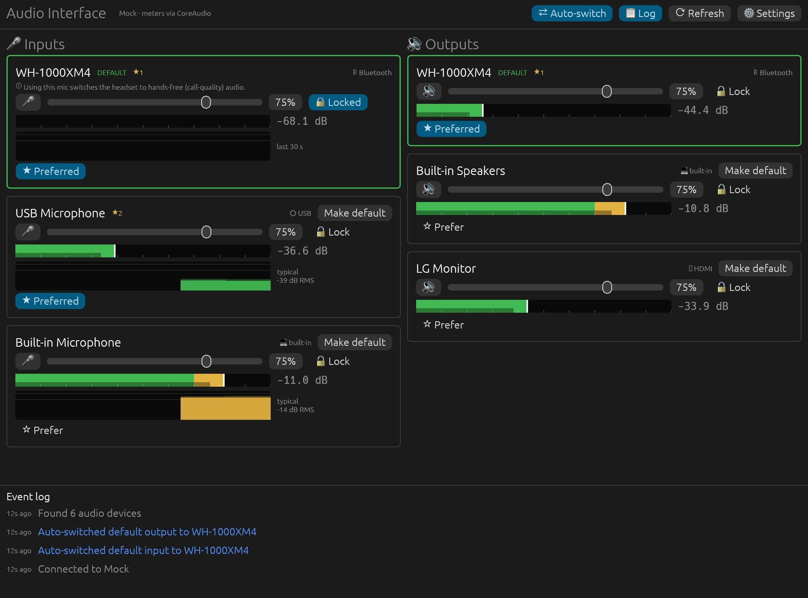

# Audio Interface

[](https://github.com/ikjbi/audioInterface/actions/workflows/ci.yml)

A small cross-platform desktop app, written in Rust, that sits between your audio devices
and the OS sound settings. It runs on **Windows, macOS and Linux**.



## What it does

- **See every device:** all inputs and outputs, which one is the system default, and how
  each is connected (Bluetooth, USB, built-in, HDMI, …).
- **One-click defaults:** make any device the system default input or output. It changes
  the real OS setting (Windows Sound settings, macOS Sound settings, PulseAudio/PipeWire).
- **Live level meters:** peak/RMS meters with peak hold and a clip indicator, so you can check
  a mic is actually picking you up. A health indicator also catches **lost signal** (the device
  stopped delivering audio) and **digital silence** (only zeros, e.g. hardware-muted).
- **Gain lock 🔒:** lock a mic's input level. If Teams, Zoom or the OS "helpfully" lowers it,
  it is put back within half a second, and the event log says what happened.
- **Preferred devices + auto-switch:** star the devices you like, in priority order. When one
  connects (say, your Bluetooth headset), it becomes the default automatically. If you then pick
  something else by hand, the app leaves your choice alone until devices change again.
- **Bluetooth hands-free warnings:** using a Bluetooth headset's mic switches the headset to the
  call-quality "hands-free" profile (HFP), which makes music sound terrible. The app tells you
  when this is happening and never opens a Bluetooth mic for metering unless you ask.
- **Event log:** connects, disconnects, default changes, gain restores and errors.
- **Scriptable CLI:** everything above is also available from the terminal.

## Install / build

You need a [Rust toolchain](https://rustup.rs) (stable, 1.88 or newer).

```sh
git clone https://github.com/ikjbi/audioInterface
cd audioInterface
cargo run --release            # opens the app
```

Pre-built binaries for each OS are attached to
[GitHub Releases](https://github.com/ikjbi/audioInterface/releases) when a version is tagged.

### Platform notes

| OS | Device control | Metering | Notes |
|---|---|---|---|
| **Windows 10/11** | MMDevice API + `IPolicyConfig` | WASAPI capture (inputs), `IAudioMeterInformation` (outputs, no capture needed) | Setting the default sets all three roles (Console, Multimedia, Communications), same as the Sound control panel. |
| **macOS 12+** | CoreAudio `AudioObject` properties | CoreAudio capture (inputs) | The first time a mic is metered, macOS asks for **microphone permission** for the app (or for your terminal, if you run it from one). Approve it under *System Settings → Privacy & Security → Microphone*. |
| **Linux** | PulseAudio native protocol (pure Rust, no libpulse) | PulseAudio capture (inputs and output monitors) | Works on PipeWire systems through `pipewire-pulse`, which is the default on modern distros. Building needs `libasound2-dev` and `pkg-config`. |

Linux build dependencies (Debian/Ubuntu):

```sh
sudo apt install pkg-config libasound2-dev libxkbcommon-dev libwayland-dev libx11-dev
```

## Command line

```text
audio-interface                          # open the app
audio-interface list [--json]            # list devices (* marks the default)
audio-interface set-default input  "AirPods"
audio-interface set-default output "Speakers"
audio-interface volume input "USB Mic"          # print the volume
audio-interface volume input "USB Mic" 80       # set it to 80%
audio-interface mute output "Speakers" toggle   # on | off | toggle
audio-interface meter                    # live meter of the default input
audio-interface meter "USB Mic" --seconds 10
```

Devices can be given by ID, exact name, or any unique part of the name (case-insensitive).
Add `--mock` to any command to use a simulated set of devices.

## How it works

```
┌────────────────────────── GUI (egui) / CLI ──────────────────────────┐
│ draws a snapshot every frame, sends requests                         │
└───────────────┬──────────────────────────────────────▲───────────────┘
                │ Request (set default, volume, …)      │ Snapshot + level cells
┌───────────────▼──────────────────────────────────────┴───────────────┐
│ Service thread: polls devices (2×/s), gain lock, auto-switch, log    │
│   ├── AudioBackend (per OS): list / set default / volume / mute      │
│   │     macOS: CoreAudio · Windows: WASAPI+IPolicyConfig · Linux: Pulse│
│   └── MeterEngine (cpal): one capture stream per metered device;     │
│         realtime callback → lock-free LevelCell → meter ballistics   │
└──────────────────────────────────────────────────────────────────────┘
```

| Module | Purpose |
|---|---|
| `src/model.rs` | `Device`, `Direction`, `Transport`, device lookup |
| `src/backend/` | `AudioBackend` trait + `macos.rs`, `windows.rs`, `linux.rs`, `mock.rs` |
| `src/meter.rs` | capture streams via `cpal` (opened off-thread, so a permission prompt can't freeze the app) |
| `src/levels.rs` | dBFS math, lock-free level hand-off, meter ballistics, signal-health detection |
| `src/rules.rs` | gain-lock and auto-switch decisions (pure, unit-tested) |
| `src/service.rs` | background worker that ties it together |
| `src/settings.rs` | JSON settings in the OS config dir |
| `src/gui.rs` | the desktop UI |

Settings are stored at:

- macOS: `~/Library/Application Support/com.ikjbi.AudioInterface/settings.json`
- Windows: `%APPDATA%\ikjbi\AudioInterface\config\settings.json`
- Linux: `~/.config/audiointerface/settings.json`

## Development

```sh
cargo test                     # unit tests (+ a read-only CoreAudio test on macOS)
cargo run -- --mock            # UI with simulated devices and animated meters
scripts/check-targets.sh       # clippy for macOS, Windows and Linux from one machine
AUDIO_INTERFACE_SCREENSHOT=shot.png cargo run -- --mock   # render, save a screenshot, exit
```

CI (GitHub Actions) builds, lints and tests on Windows, macOS and Linux. On Linux it also
runs an integration test against a real PulseAudio server with virtual devices. That test
switches defaults, changes volume and mute, and checks the meters read a 440 Hz test tone at
the right level (`scripts/ci-linux-pulse.sh`).

See [PLAN.md](PLAN.md) for the roadmap and [CHANGELOG.md](CHANGELOG.md) for changes.

## License

[MIT](LICENSE)
